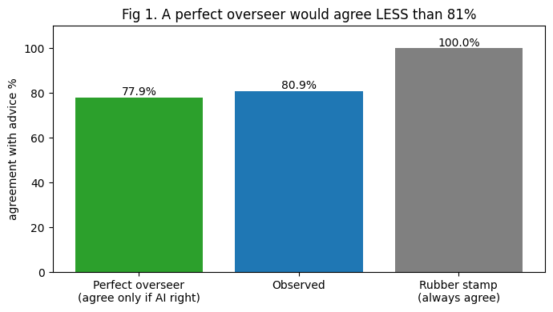
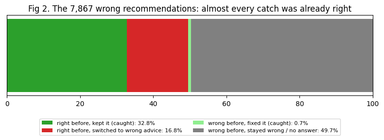
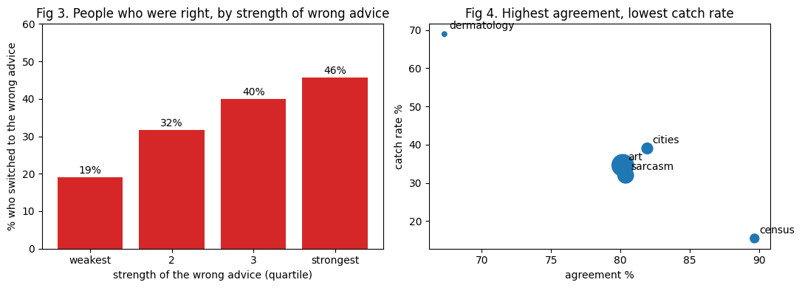

# Does oversight work?

Koru Impact work sample, October 2026.

| File | What it is |
|---|---|
| `task1_oversight.ipynb` | Task 1: code, figures and answers to questions 1 to 4 |
| `METHOD_NOTE.md` | Task 3: method note |
| `TIME_LOG.md` | Time log |
| `board_page.pdf`, `board_page.docx` | Task 2: one page for the board (also sent by email) |
| `data/haiid_dataset.csv` | The dataset (copy of commit `24881cc`), read by the notebook |
| `data/haiid_dataset_description.csv` | Column descriptions from the dataset repo |
| `data/LICENSE-haiid.txt` | MIT licence of the dataset |

## Key findings

A bank is told its staff "agree with the AI 81% of the time", and that this proves human oversight works. The data says otherwise.

| | Result |
|---|---|
| Agreement with the advice | **80.9%** (reproduces the 81% claim) |
| Agreement a perfect reviewer would show | **77.9%**, the advice's own accuracy. So 81% is *more* agreement than good oversight would give |
| Wrong advice that people still followed | **63.6%** |
| Catch rate: wrong advice that the reviewer's final answer corrected | **33.5%**, so two in three wrong recommendations went through |
| People who were right, then switched to the wrong advice | **33.9%** |
| People who were wrong, then recovered on their own | **1.4%** |

What else the data shows:

- **Confident mistakes are the hardest to catch.** Among people who were right, 19.1% switched to the weakest wrong advice and 45.7% to the strongest.
- **How the tool is described changes how much it gets checked.** People told the advice was 95% accurate caught 10 points fewer of its errors than people told 65%, for the same advice.

**What to measure instead:** the catch rate, reported next to agreement when the AI is right and the accuracy of person plus AI, so it can't be gamed by overriding everything. The notebook maps this to the Qatar Central Bank AI Guideline, section 13.4.

All numbers come from `task1_oversight.ipynb`, with 95% intervals that resample people. See `METHOD_NOTE.md` for the method and how confident each finding is.

## Re-running

1. The dataset is included in `data/` (commit `24881cc` of github.com/kailas-v/human-ai-interactions, 27 Oct 2022, 35,670 rows).
2. Install Python 3.11 and run `pip install -r requirements.txt`.
3. Open `task1_oversight.ipynb` and choose Run All. It takes under a minute. The resampling uses a fixed seed, so the intervals come out the same on every run.

## Sources

- Vodrahalli, K., Daneshjou, R., Gerstenberg, T. and Zou, J. (2022). Do humans trust advice more if it comes from AI? AIES '22, 763–777. Method read from arXiv 2107.07015.
- Dataset: github.com/kailas-v/human-ai-interactions, MIT licence, copyright (c) 2022 Kailas Vodrahalli.
- Qatar Central Bank (2024). Artificial Intelligence Guideline, Part C, section 13. In force 4 Sep 2024. PDF from https://www.qcb.gov.qa/Services/Financial%20Technology/QCB_Artificial_Intelligence_Guideline.pdf, read 18 Oct 2026.
